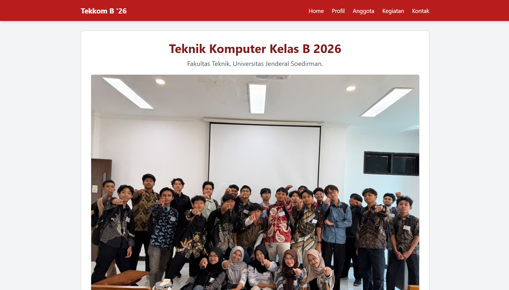
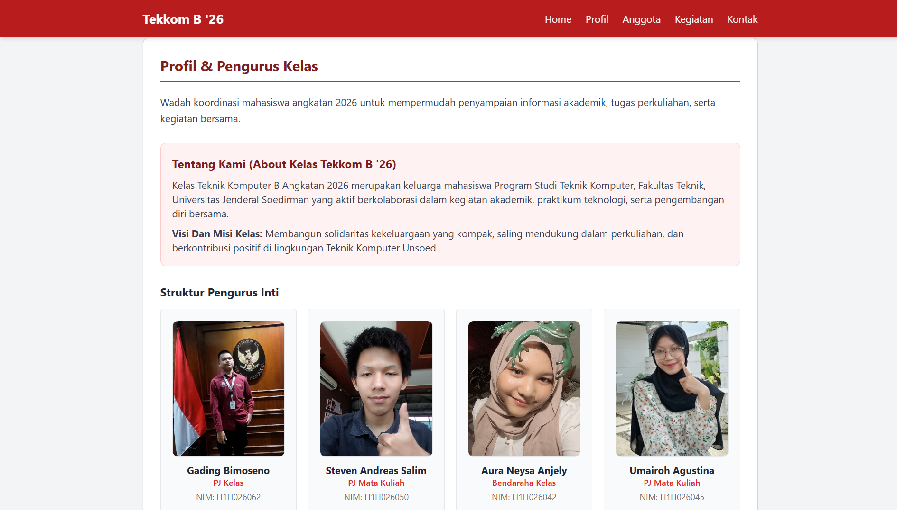
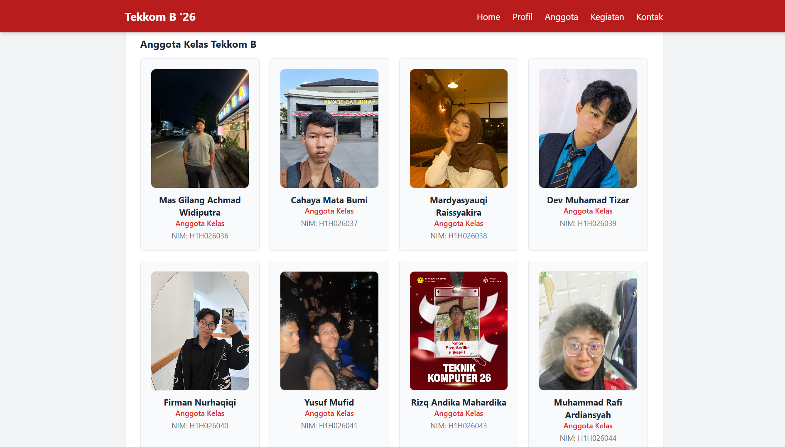
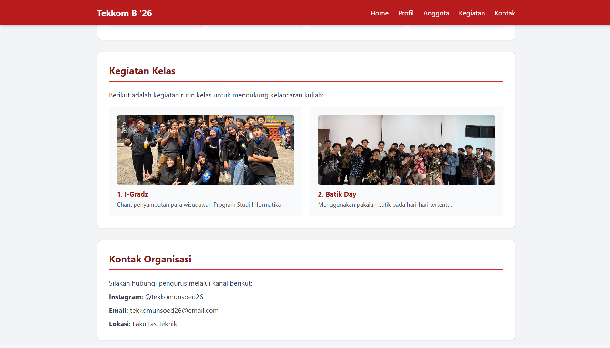

# Website Paguyuban Kelas Teknik Komputer B '26

Website statis resmi profil dan pusat informasi mahasiswa **S-1 Teknik Komputer Kelas B Angkatan 2026**, Fakultas Teknik, Universitas Jenderal Soedirman. Dibangun sebagai tugas akhir kolaborasi *Weekly Meet Catalyst (Build Together: Collaborative Mini Project)*.

## Anggota Kelompok
1. **Rafli Rusdiana Sadeli** - [@rafli1407](https://github.com/rafli1407)
2. **Umairoh Agustina (Mai)** - [@umairohagustina2-cmd](https://github.com/umairohagustina2-cmd)
3. **Keyshia Shakila Eshan** - [@keyshiashakilaeshan-cpu](https://github.com/keyshiashakilaeshan-cpu)
4. **Atha Aulia Rahma** - [@athaullia07](https://github.com/athaullia07)

## Tujuan & Latar Belakang Project
Project ini dibuat sebagai wadah koordinasi dan identitas digital mahasiswa Teknik Komputer Kelas B 2026 Unsoed untuk memperkenalkan profil kelas, visi-misi, struktur pengurus inti, daftar anggota kelas, kegiatan rutin, serta kanal kontak resmi kelas secara terpusat.

## Fitur & Section Website
- **Home / Hero Section:** Identitas kelas, foto bersama, dan tombol navigasi utama.
- **About / Tentang Kelas & Visi Misi:** Penjelasan latar belakang serta visi dan misi kelas Tekkom B '26.
- **Struktur Pengurus & Daftar Anggota Kelas:** Profil pengurus inti dan daftar anggota kelas beserta foto dan NIM.
- **Main Content (Kegiatan Kelas):** Dokumentasi kegiatan rutin mahasiswa (I-Gradz, Batik Day).
- **Contact & Footer:** Informasi media sosial resmi (`@tekkomunsoed26`), email, lokasi kampus, dan footer.

## Teknologi yang Digunakan
- HTML5
- CSS3 & Tailwind CSS (via CDN)
- JavaScript Dasar
- Git & GitHub untuk kolaborasi tim

## Dokumentasi Tampilan Website

### 1. Halaman Utama (Hero Section)

### 2. Bagian About & Pengurus Kelas

### 3. Daftar Anggota Kelas

### 4. Kegiatan Kelas & Kontak
